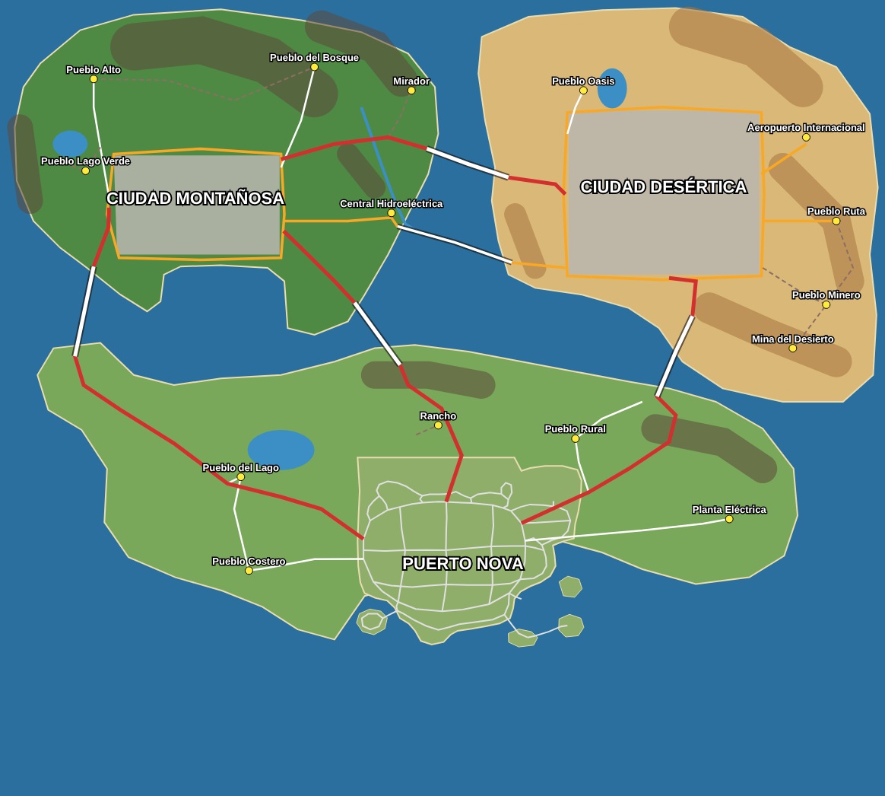

# Plan maestro del mundo de Nova RP (etapa 1: planificación)

Referencia: la imagen del mapa con las tres regiones (Costera abajo, Montañosa arriba a la
izquierda, Desértica arriba a la derecha). Plano trazado en `shared/worldplan.js`, validado y
dibujado con `node tools/plan-world.js docs/plan-mundo.svg`.

## 1. Escala y coordenadas

- **4.4 m por píxel de la imagen.** Con esta escala la ciudad actual (Puerto Nova) cae exactamente
  donde la imagen dibuja la Ciudad Costera, con su puerto, playas e islas en su lugar.
- Mundo completo: **~5.8 km × 5.2 km** (compacto, del tamaño de San Andreas).
- La barra de escala dibujada en la imagen ("0–3 km") daría ~25 km: se descarta porque el mundo
  sería enorme y la ciudad actual quedaría diminuta.
- Coordenadas: las mismas del juego actual (+X este, +Z sur, metros). La ciudad actual no se mueve.

## 2. Regiones, ciudades y pueblos

| Región | Ciudad principal | Pueblos y lugares |
|---|---|---|
| Costera (abajo) | Puerto Nova (la actual) | Pueblo del Lago, Pueblo Costero, Pueblo Rural, Rancho, Planta Eléctrica |
| Montañosa (arriba izq.) | Ciudad Montañosa (con puerto al sur) | Pueblo Alto, Pueblo del Bosque, Pueblo Lago Verde, Mirador, Central Hidroeléctrica |
| Desértica (arriba der.) | Ciudad Desértica | Pueblo Oasis, Pueblo Ruta, Pueblo Minero, Mina, **Aeropuerto Internacional** |

- Las regiones están separadas por mar (validado: ningún polígono se encima con otro).
- Cada pueblo está fuera de su ciudad, en tierra de su región y con camino (validado).

## 3. Red vial principal

- **A1 Autopista del Poniente** (Puerto Nova → Montañosa): sale del Anillo Periférico, rodea el
  lago por el sur, pasa por Pueblo del Lago y cruza al noroeste por un puente de ~640 m.
- **A2 Autopista Central** (Puerto Nova → Montañosa): sale al norte por la Av. Juárez, pasa junto
  al Rancho y cruza por un puente de ~540 m.
- **A3 Autopista del Norte** (Montañosa → Desértica): puente de ~620 m.
- **A4 Autopista del Oriente** (Puerto Nova → Desértica): pasa por el Pueblo Rural, puente de ~620 m.
- **C1 Carretera de la Hidroeléctrica** (Montañosa → Desértica): segundo puente, ~840 m.
- Periféricos: el Anillo de Puerto Nova (ya existe), el Periférico de la Sierra y el Circuito del
  Desierto.
- Caminos secundarios y de terracería a cada pueblo, mirador, rancho, mina y aeropuerto; la Ruta de
  la Sierra lleva un túnel.

## 4. Qué pasa con la ciudad actual

- **Se conserva todo:** barrios, calles, sitios, puerto, playas, islas del faro y de la prisión,
  presa y su lago, concesionarios.
- La costa sur y este de la ciudad no cambian. Al norte, oeste y noreste se agrega el campo de la
  Región Costera (el borde norte/oeste actual queda tierra adentro).
- **El aeropuerto se muda a la Región Desértica** (como en la imagen). Su terreno actual (noreste)
  queda como zona industrial y de carga junto al Pueblo Rural.

## 5. Arquitectura técnica (para que funcione en celulares)

El mundo es ~11 veces más grande que el mapa actual. Generarlo todo al cargar no es viable en un
celular, así que:

1. **Una región = un generador independiente** (terreno, calles, manzanas, lotes, sitios). El
   cliente genera primero la región donde está el jugador y las otras en segundo plano.
2. **Terreno de dos resoluciones:** 4 m en ciudades y pueblos, 8 m en montañas, desierto y campo.
3. Se mantienen los mosaicos de 64 m con LOD que ya existen (solo se dibuja lo cercano), los
   materiales compartidos y la geometría fusionada.
4. El servidor genera las tres regiones al arrancar (validación de movimiento, disparos y trabajos)
   y no cambia el protocolo multijugador.
5. Los puentes y autopistas entre regiones forman una red propia que une las tres redes de calles.

## 6. Validación vial (obligatoria)

`node tools/plan-world.js` ya corre dentro de `npm test`:

- regiones separadas por mar; ciudades y pueblos dentro de su región;
- carreteras sobre tierra; puentes con ambos extremos en tierra y cruzando agua;
- grafo vial: ruta entre las tres ciudades y acceso a cada pueblo y lugar.

En las etapas 3 y 4 se agrega la validación física sobre la red construida: pendientes máximas,
curvas imposibles, cruces falsos, calles duplicadas, accesos a hospitales, comisarías y
gasolineras, y recorridos con el colisionador del vehículo.

## 7. Etapas siguientes

1. ~~Planificación~~ (este documento)
2. ~~Geografía~~: costas de las tres regiones, montañas (cordilleras, cañones), lagos, río, playas,
   desierto y vegetación natural por región (`shared/vegetation.js`).
3. Red vial: autopistas, puentes con soportes y barandal, periféricos, caminos; validación física.
4. Urbanismo: barrios y manzanas de las dos ciudades nuevas y de los pueblos.
5. Construcción: edificios con arquitectura propia por región (montaña / desierto).
6. Decoración: vegetación por región, señales, mobiliario.
7. Iluminación nocturna por zona (centro más iluminado, carreteras rurales oscuras).
8. Optimización y pruebas en el juego.
